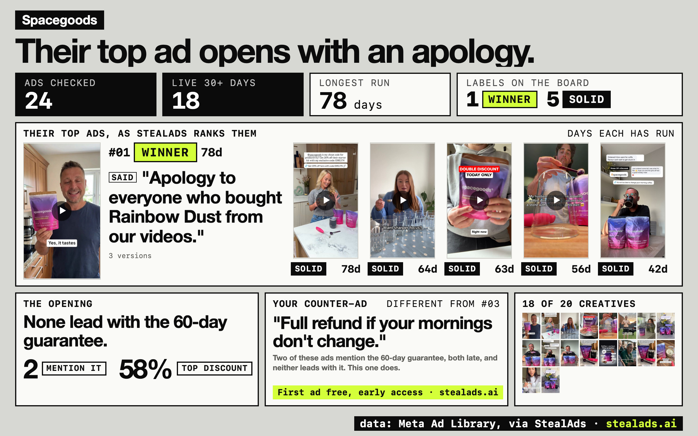

# ad-spy-kit

**Name a competitor. Get one board of the Meta ads they keep running, every hook and offer quoted word for word, the opening none of them use, and a brief for your counter-ad.**

<p align="center">
  
</p>

Above: a real recorded run on a public brand (Spacegoods, recorded on Oct 28, 2026). It's
a sample, not a verdict on them. Open the
[text version](artifacts/screenshots/live/spacegoods/teardown.md) or the five
[X slices](artifacts/screenshots/live/spacegoods/x-slices/), and rebuild it offline with
`uv run ad-spy-kit replay --sample live/spacegoods`.

## Get started: connect StealAds (primary)

The fastest way to run the kit is with the StealAds MCP. Your agent pulls ads through it,
so you don't need a ScrapeCreators key or a `.env` file. StealAds is in early access. Get
access here: https://stealads.ai

1. Add the MCP to your agent. In Claude Code:

   ```bash
   claude mcp add --transport http stealads https://mcp.stealads.ai/mcp
   ```

   Sign in at https://app.stealads.ai first, then run `/mcp` inside Claude Code and
   connect stealads. Codex and other agents: add the same URL as a remote (HTTP) MCP
   server and connect when it asks. If connecting drops you on the StealAds home page
   instead of back in your agent, go back to your agent and press connect again.
2. Install the kit (below), then tell your agent: **"tear down [competitor]'s Black Friday
   ads."** If the StealAds tools are in the session, the agent uses them.

No access yet? Skip to [Alternate path: a ScrapeCreators key](#alternate-path-a-scrapecreators-key-no-stealads-access-needed).
It's a full path, not a demo.

## What you get

- **The ads they keep running**, sorted by how long each has run, with days live and how
  many versions they've made.
- **Every hook and offer quoted word for word**, tied to the ad it came from, and tagged
  with where it's said: out loud, on screen, or in the caption.
- **The opening**: what none of their ads say.
- **A counter-ad brief**: headline, hook, what to show, and why it's different from theirs.

## How the labels work

You can't see a competitor's sales. You can see what they keep paying for. Every ad gets
one label, from facts on the ad:

| Label | Means |
|---|---|
| **winner** | live 120+ days, or 60+ days with 3+ versions (a stopped ad: ran 365+ days with 3+ versions, or 540+ days) |
| **solid** | 30+ days, or 14+ days with 3+ versions |
| **testing** | live under 30 days |
| no label | start date unknown, or stopped before 30 days |

Catalog ads (DPA) and dynamic-creative ads (DCO) store template text like
`{{product.name}}`, not words. The kit treats that as empty, never quotes it, quotes the
ad's real caption line instead, and tags the ad "catalog ad" on its card. A category board
counts catalog ads but keeps them off its cards.

The rule matches StealAds, and the kit applies it to
ScrapeCreators data too (`ad_spy_kit/labels.py`). Running long doesn't prove an ad
works. A dropshipper's Black Friday ad can run for 13 months. The kit shows you what they
keep paying for; you still look at it and make the call.

## Install

```bash
npx skills add TheMattBerman/ad-spy-kit
```

Then tell your agent: **"tear down [competitor]'s Black Friday ads."** The first time, the
skill installs the browser it draws boards with (one command, it runs it for you).

Or as a Claude Code plugin:

```text
/plugin marketplace add TheMattBerman/ad-spy-kit
/plugin install ad-spy-kit@ad-spy-kit
```

Or from a clone (installs everything, safe to rerun):

```bash
git clone https://github.com/TheMattBerman/ad-spy-kit.git ad-spy-kit && cd ad-spy-kit
./install.sh
bash doctor.sh          # checks Python, the browser, and which data path you have
```

`./install.sh` tells you what it replaced and whether
Chromium installed. If `~/.claude/skills/ad-spy-kit` already links to a different checkout,
it stops and leaves it alone; rerun with `--force` to switch.

Needs [uv](https://docs.astral.sh/uv/). Doing it by hand? Run this once in the kit's
folder: `uv sync && uv run playwright install chromium`.

## Try it with no key

The kit ships with sample brands, so you can see a board before you spend a credit:

```bash
uv run ad-spy-kit replay --sample foldbrook     # a made-up wallet brand
uv run ad-spy-kit replay --sample live/spacegoods   # the real recording above
```

`foldbrook`, `dewbar` and `fizzwell` are made-up brands with made-up ads. Every one of their
boards says so in the header.

## Alternate path: a ScrapeCreators key (no StealAds access needed)

Don't have StealAds access yet? Use this. Same boards, same labels. You pay ScrapeCreators
per request instead (costs below), and the kit quotes every cost before it spends. When you
get StealAds access (https://stealads.ai), connect it and the agent uses it first.

Add a [ScrapeCreators](https://scrapecreators.com) key to a `.env` file in the folder you
run from (`SCRAPECREATORS_API_KEY=...`), or export it. Then:

```bash
uv run ad-spy-kit run "Brand Name"
```

It reads up to **30 of the brand's ads that have been live 30+ days**, the ones Meta has
shown most, and sorts them by how long each has run. That's what they keep paying for. Want
what they're trying right now instead? Add `--newest` for their newest 30 live ads. You can
name the brand, or paste its page ID or its Ad Library page link (the one with
`view_all_page_id=` in it).

**It tells you the cost before it spends anything.** In a terminal it prints the quote and
asks `Go? [y/N]`. With no terminal (an agent, a script) it prints the quote, spends nothing,
and exits; rerun the same command with `--yes` to spend. ScrapeCreators charges 1
credit per request: one to find the brand's page, then one per page of ads. The first page
holds about 30 ads and each page after that about 10. So one brand is about 2 credits;
reading 60 ads costs about 5, and 90 about 8. When a read of 30 looks thin (the longest run
is under 120 days, or catalog and duplicate ads fill the pool), `ad-spy-kit winners` says so
and prints what `--max-ads 60` costs. ScrapeCreators has no "longest running first" sort
(only most-shown and most-recent), so `--min-days 120` is the lever for old ads: it reads
only ads that were already running 120 days ago, at the same cost.

**The CLI pulls; your agent writes.** `run` finds the page, reads the ads, saves the
images and sorts them. It stops there: the headline, hooks, offers, the opening and the
counter brief are written by your agent (it looks at the ads), and `ad-spy-kit render` draws
the board after that. So the board appears after the agent step. The easy way is to skip the
steps and tell your agent **"tear down Quince's ads"**. It runs the whole flow.

## A whole category

```bash
uv run ad-spy-kit category "black friday skincare"
uv run ad-spy-kit category "Brand A, Brand B, Brand C"
```

A keyword finds the brands running matching ads (up to 10); a list names them (up to 10).
Either way you get one board of at most 10 brands: each brand's ads that have been live 30+
days (up to 30), labeled with the same rule, longest first, with three of each brand's ads
shown, plus up to four 1080x1350 slices for X. `--newest` shows their newest ads instead,
and the board says so. A keyword run with 10 brands costs about 11 to 12 credits, quoted
before anything is spent. Every image is saved inside the board, so it still works when you move or share it.
`--from <folder>` redraws a saved run for free.

Big lists work too. `--brands-file brands.csv` (columns: name, page_id, country) reads every
brand in the file. `--read most-shown` reads each brand's 30 most-shown live ads of any age
(1 credit a brand) and counts, by age, how many say Black Friday and how many say "up to X%
off". `--max-credits` is a hard cap, `--workers 4` reads four brands at once, and rerunning
with the same `--out` picks up where it stopped without paying twice. The board shows the
top 10 brands; `summary.md` and `ads.csv` hold every brand and every ad.

### Your tracked competitors (StealAds)

Track rivals in StealAds, then ask your agent "show me what my competitors keep running".
It reads the ads of the rivals you track (free, no credits), saves them as
`tracked_rival_ads*.json`, and `ad-spy-kit tracked <folder>` draws the same board: the top
10 brands by number of ads live 30+ days, three ads each, StealAds' own labels. A workspace
with hundreds of tracked rivals is over the read limit of `list_tracked_rival_ads`; the
agent then reads the rivals you name one at a time (details in `SKILL.md`).

## From brief to ad

Every board ends with a written counter-ad brief, on the board and in `teardown.md`. Hand it
to your designer, or use it as a prompt in any image tool.

StealAds can turn this brief into a finished ad. Your first one is free. Access: https://stealads.ai

## Commands

Your agent runs these; each one also works by hand.

| Command | Does |
|---|---|
| `ad-spy-kit run "<brand>"` | quote, then read the ads they've kept running 30+ days and sort them |
| `ad-spy-kit category "<keyword or brands>"` | up to 10 brands on one sorted board |
| `ad-spy-kit tracked <folder>` | StealAds: saved tracked-rival ads → one board, top 10 brands (free) |
| `ad-spy-kit replay --sample foldbrook` · `replay-all` | rebuild a sample board offline |
| `ad-spy-kit render <folder>` | draw the board, 5 X slices, newsletter and preview images, then check them |
| `ad-spy-kit validate <folder>` | run the checks on their own |
| `ad-spy-kit onscreen <folder>` | list the board's images for your agent to read, then `--apply` the notes it saved in `onscreen.json` (an image with no words is recorded as `"no_text": true`) |
| `ad-spy-kit transcripts <folder>` | quote, then fetch what the video ads say out loud |
| `ad-spy-kit transcribe-mode [on\|off]` | read videos with OpenRouter instead (your key, your bill) |
| `ad-spy-kit correct …` | turn a fix you made into a rule every future board follows |
| `ad-spy-kit explain <code>` | if you use StealAds: what its error means and what to do |

### Video transcripts

What a video ad says out loud comes from ScrapeCreators transcripts (1 credit per video,
quoted first). To read speech and on-screen text in one pass, turn on OpenRouter with
`ad-spy-kit transcribe-mode on` and an `OPENROUTER_API_KEY`. It's off unless you turn it on,
and OpenRouter bills you for each video. `ad-spy-kit transcribe-mode` shows what's on.

## What it can't tell you

- **Spend and sales.** Meta doesn't publish spend for US commercial ads. The board shows how
  long ads ran and how many versions exist, never a guess at spend or results.
- **Every ad.** It reads up to 30 ads per brand (`--max-ads` reads more, at about 1 credit
  per 10 extra ads).
- **Videos with no preview image** are skipped and counted.
- **Whether the opening is a good bet.** The checks catch made-up quotes, numbers the ads
  don't print, and hedging. Whether to go for the opening is your call.
- **Countries.** US by default; other markets work if the data covers them.

## Checks

A board that fails a check is not left looking final: `render` renames its images to
`board.failed.png`, `x-slices.failed/` and so on, and says so. Fix the problem and render again.
Images are saved and embedded at most 1200px on the long edge (a six-ad board is about 2 MB,
not 26); add `--keep-originals` to `run` or `pull` to keep the full-size files too.

```bash
bash scripts/test.sh     # the full test suite
uv run ad-spy-kit golden # sample boards haven't drifted
```

Built by [@TheMattBerman](https://x.com/TheMattBerman). MIT. StealAds: https://stealads.ai.
